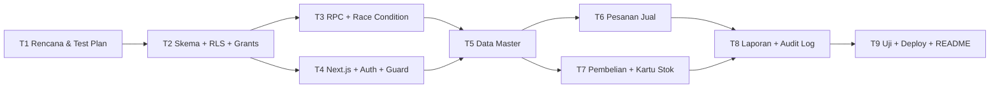

# 01 — Rencana Kerja

Rujukan: [00-spesifikasi.md](00-spesifikasi.md), [02-matriks-akses.md](02-matriks-akses.md), [03-test-plan.md](03-test-plan.md), [04-asumsi-dan-celah.md](04-asumsi-dan-celah.md).

Prinsip: satu tahap per sesi. Logika bisnis ada di database (RPC). Next.js hanya lapisan tampilan dan pemanggil. Setiap tahap ditutup dengan ringkasan (selesai / bukti uji / belum) sesuai `AGENTS.md`.

## Ringkasan Dependensi



---

## T1 — Rencana Kerja, Matriks Akses, Test Plan
| Aspek | Isi |
|---|---|
| Tujuan | Menyepakati lingkup, hak akses, keputusan untuk celah spesifikasi, dan kriteria uji sebelum ada kode. |
| Deliverable | `AGENTS.md`, `docs/00-spesifikasi.md` s.d. `docs/04-asumsi-dan-celah.md`. |
| Dependensi | Spesifikasi sumber. |
| Risiko utama | Celah spesifikasi tidak tertangkap sehingga terjadi pengerjaan ulang di T2/T3. |
| Definition of Done | (1) 5 file `docs/` + `AGENTS.md` ada di repo. (2) `03-test-plan.md` berisi tepat 28 TC, dan setiap BR-01..BR-12 terpetakan ke ≥1 TC. (3) Tidak ada file kode. (4) Sudah di-commit ke `main`. |

## T2 — Migrasi Skema 9 Tabel + Constraint + Index + View + RLS + Column Grants
| Aspek | Isi |
|---|---|
| Tujuan | Membangun skema database yang aman sejak awal: semua aturan struktural ditegakkan lewat constraint dan RLS. |
| Deliverable | `supabase/migrations/<ts>_skema_inti.sql` (9 tabel, CHECK, UNIQUE, FK, index), `<ts>_rls_grants.sql` (RLS per tabel, `REVOKE` kolom rahasia, `GRANT` kolom eksplisit), `<ts>_views.sql` (view publik `security_invoker=true`, view `v_*_manajer` dengan cek peran), helper `peran_saya()`, trigger `handle_new_user`, trigger guard kolom per peran, sequence nomor dokumen, `supabase/seed.sql` (data contoh tanpa kredensial asli). |
| Dependensi | T1. |
| Risiko utama | View melewati RLS (security definer default). `SELECT *` gagal karena grant kolom. Rekursi RLS pada `profiles`. Kebocoran kolom rahasia lewat FK embed PostgREST. |
| Definition of Done | (1) `supabase db reset` sukses tanpa error. (2) Sebagai `penjualan`, `select harga_pokok from barang` → error permission denied. (3) `select * from v_barang_manajer` sebagai `penjualan`/`gudang` → 0 baris atau error. (4) INSERT `barang` dengan `harga_jual=0` atau `stok=-1` → ditolak CHECK. (5) UPDATE langsung `barang.stok` oleh peran mana pun → ditolak. (6) TC SQL terkait (TC-01..TC-06, TC-07..TC-09) bisa dijalankan dan lolos. |

## T3 — Fungsi RPC + Proteksi Race Condition
| Aspek | Isi |
|---|---|
| Tujuan | Seluruh aturan bisnis BR-02..BR-12 diimplementasikan sebagai fungsi `SECURITY DEFINER` dengan `search_path` terkunci. |
| Deliverable | Migrasi RPC: `buat_pesanan`, `simpan_item_pesanan`, `hapus_item_pesanan`, `konfirmasi_pesanan`, `batalkan_pesanan`, `kirim_pesanan`, `lunasi_pesanan`, `ajukan_pembelian`, `putuskan_pembelian` (setujui/tolak), `batalkan_pembelian`, `terima_pembelian`, `sesuaikan_stok`, `ubah_batas_kredit`, `ubah_harga_jual`, `ubah_peran`, `buat_barang`. Helper `catat_audit()`. Skrip uji SQL `supabase/tests/*.sql` (pgTAP atau skrip psql). Skrip uji konkurensi (2 sesi psql paralel). |
| Dependensi | T2. |
| Risiko utama | Deadlock jika urutan kunci tidak konsisten. Pesan error membocorkan HPP. Fungsi `SECURITY DEFINER` tanpa cek peran. Pembulatan subtotal tidak konsisten (`round` numeric vs float). |
| Definition of Done | (1) Semua RPC memeriksa `peran_saya()` dan `aktif`. (2) Kunci `FOR UPDATE` pada pelanggan lalu barang (diurutkan `id`) di `konfirmasi_pesanan`. (3) Uji konkurensi 2 sesi: satu sukses, satu gagal, stok ≥ 0 (TC-18, TC-19). (4) TC-10..TC-28 lapisan SQL lolos. (5) Tidak ada pesan error yang memuat angka HPP/harga beli. |

## T4 — Inisialisasi Next.js + Supabase Client + Auth + Middleware Route Guard
| Aspek | Isi |
|---|---|
| Tujuan | Kerangka aplikasi siap: login, sesi, guard rute per peran, layout ERP. |
| Deliverable | Proyek Next.js App Router + TypeScript strict + Tailwind. `@supabase/ssr` (client browser & server). Halaman `/masuk`. `middleware.ts` (redirect ke `/masuk` jika belum login, tolak akun nonaktif, guard prefix rute per peran). Layout sidebar per peran. Meta `robots: noindex` + header `X-Robots-Tag`. `.env.example`. Tipe hasil `supabase gen types`. |
| Dependensi | T2 (tabel `profiles`, trigger). |
| Risiko utama | Middleware dianggap satu-satunya pengaman (keliru, karena DB tetap penegak utama). Cookie sesi tidak ter-refresh. Service-role key ikut terpakai. |
| Definition of Done | (1) `npm run build` sukses, `tsc --noEmit` tanpa error. (2) Tiga akun uji bisa masuk dan diarahkan ke dashboard sesuai peran. (3) Akses `/laporan` oleh penjualan → redirect/403. (4) Akun nonaktif tidak bisa masuk. (5) `grep -r SERVICE_ROLE` → tidak ada hasil. (6) TC-01, TC-02 lapisan UI lolos. |

## T5 — Modul Data Master (Pelanggan, Barang, Pemasok, Profil)
| Aspek | Isi |
|---|---|
| Tujuan | CRUD data master sesuai matriks akses. |
| Deliverable | Halaman Barang & Stok (daftar, cari, label stok menipis, form tambah khusus Manajer, form ubah per peran, kolom harga pokok khusus Manajer). Pelanggan (daftar, form, piutang berjalan; batas kredit hanya Manajer). Pemasok (Gudang/Manajer). Pengaturan Akun (Manajer: ubah peran/aktif). |
| Dependensi | T3, T4. |
| Risiko utama | Form mengirim kolom terlarang (misal `harga_jual` oleh Gudang), padahal DB akan menolak sehingga UX jadi buruk. Data rahasia ikut terkirim di payload RSC. |
| Definition of Done | (1) Gudang mengubah nama/satuan/stok_minimum/aktif → sukses; mengubah harga → ditolak DB. (2) Pelanggan baru dari Penjualan → `batas_kredit = 0`. (3) Payload jaringan halaman Barang untuk Penjualan tidak memuat `harga_pokok`. (4) TC-07..TC-09 UI lolos. |

## T6 — Modul Pesanan Jual
| Aspek | Isi |
|---|---|
| Tujuan | Alur pesanan lengkap dari draf sampai lunas/dibatalkan. |
| Deliverable | Daftar pesanan (filter status/pelanggan/tanggal; visibilitas per peran). Detail/form draf (pilih pelanggan aktif, maksimal 20 baris, diskon per baris, total live). Tombol status sesuai peran dan status. Dialog alasan batal. Panel HPP/margin khusus Manajer. |
| Dependensi | T5. |
| Risiko utama | Perhitungan subtotal di klien berbeda dengan DB, padahal DB adalah sumber kebenaran. Tombol tampil untuk peran yang salah. |
| Definition of Done | (1) TC-10..TC-17, TC-20..TC-22 lolos di lapisan UI. (2) Pesan error RPC tampil persis. (3) Gudang tidak melihat draf. |

## T7 — Modul Pembelian (PO) + Penerimaan + Kartu Mutasi Stok
| Aspek | Isi |
|---|---|
| Tujuan | Siklus PO dan pencatatan semua mutasi stok. |
| Deliverable | Daftar & form pengajuan PO. Aksi setujui (isi harga beli)/tolak (alasan) untuk Manajer. Form terima barang. Halaman kartu stok per barang. Form penyesuaian stok. Tab pemasok. |
| Dependensi | T5. |
| Risiko utama | Kolom harga beli terkirim ke Gudang. Penerimaan ganda karena klik dua kali (harus ditolak DB). |
| Definition of Done | (1) TC-23..TC-26 lolos. (2) Σ mutasi per barang = stok saat ini (rekonsiliasi query). (3) Payload halaman PO untuk Gudang tanpa `harga_beli_satuan`. |

## T8 — Laporan Margin/Omzet (Grafik Mingguan) + Piutang + Audit Log
| Aspek | Isi |
|---|---|
| Tujuan | Dashboard per peran dan laporan Manajer. |
| Deliverable | View/RPC laporan khusus Manajer (`laporan_mingguan`, `laporan_margin_barang`, `laporan_piutang`). Grafik batang 8 minggu. Tabel top/bottom margin barang. Umur piutang. Ekspor CSV. Halaman Audit Log (filter aksi & tanggal). Dashboard Penjualan & Gudang tanpa angka rahasia. |
| Dependensi | T6, T7. |
| Risiko utama | Batas minggu salah zona waktu. RPC laporan dapat dipanggil non-Manajer. |
| Definition of Done | (1) Angka laporan dari data contoh cocok dengan perhitungan manual SQL. (2) RPC laporan oleh penjualan → error akses. (3) TC-27, TC-28 lolos. |

## T9 — Eksekusi Test Plan + Deploy Netlify + README + Verifikasi Rilis
| Aspek | Isi |
|---|---|
| Tujuan | Rilis terverifikasi. |
| Deliverable | `docs/03-test-plan.md` dengan kolom Status terisi (Lulus/Gagal + bukti). Deploy Netlify (`netlify.toml`, env var di dashboard). `README.md` (setup, env, akun uji, arsitektur keamanan). Checklist rilis. |
| Dependensi | T8. |
| Risiko utama | Env var salah di Netlify. Redirect URL Supabase Auth belum diatur. Halaman terindeks mesin pencari. |
| Definition of Done | (1) 28/28 TC dijalankan; minimal semua TC kritis (RBAC, BR-04, BR-05, BR-06) lulus. (2) URL Netlify aktif, `curl -I` menunjukkan `X-Robots-Tag: noindex`. (3) Repo publik tanpa rahasia (scan `git log -p` untuk key). (4) README lengkap. |

---

## Struktur Folder Repo (Target)

```text
/
├─ AGENTS.md
├─ README.md
├─ PRD_ERP.md
├─ .env.example
├─ netlify.toml
├─ docs/
│  ├─ 00-spesifikasi.md … 04-asumsi-dan-celah.md
├─ supabase/
│  ├─ config.toml
│  ├─ migrations/        # <timestamp>_<deskripsi>.sql
│  ├─ tests/             # uji SQL per BR / TC
│  └─ seed.sql
├─ src/
│  ├─ app/
│  │  ├─ (auth)/masuk/
│  │  ├─ (app)/dashboard/
│  │  ├─ (app)/barang/
│  │  ├─ (app)/pelanggan/
│  │  ├─ (app)/pesanan/
│  │  ├─ (app)/pembelian/
│  │  ├─ (app)/laporan/
│  │  └─ (app)/pengaturan/
│  ├─ components/        # ui/ (tabel, badge, form), domain/
│  ├─ lib/supabase/      # client.ts, server.ts, middleware.ts
│  ├─ lib/format.ts      # format rupiah & tanggal
│  └─ types/database.ts  # hasil supabase gen types
└─ middleware.ts
```

## Strategi Branch & Commit
- `main` selalu dapat di-deploy. Kerja per tahap di branch `tahap/t<N>-<ringkas>` (contoh `tahap/t3-rpc`), lalu merge ke `main` setelah DoD terpenuhi.
- Format **Conventional Commits** dalam Bahasa Indonesia: `docs: …`, `feat(db): …`, `feat(ui): …`, `fix: …`, `test: …`, `chore: …`.
- Satu migrasi = satu commit bermakna. Migrasi yang sudah di-push **tidak diedit**; perbaikan dibuat sebagai migrasi baru.
- Sebelum commit: pastikan `.env*` (kecuali `.env.example`) masuk `.gitignore`.

## Konvensi Penamaan
| Objek | Konvensi | Contoh |
|---|---|---|
| Tabel/kolom | snake_case Indonesia | `pesanan_jual.jatuh_tempo` |
| View publik | `v_<tabel>` | `v_barang`, `v_pembelian` |
| View manajer | `v_<tabel>_manajer` | `v_barang_manajer` |
| RPC | `<kata_kerja>_<objek>` | `konfirmasi_pesanan` |
| Trigger | `trg_<tabel>_<tujuan>` | `trg_barang_guard_kolom` |
| Fungsi trigger | `fn_<tujuan>` | `fn_guard_kolom_barang` |
| Migrasi | `<YYYYMMDDHHMMSS>_<deskripsi>.sql` | `20261021120000_skema_inti.sql` |
| Komponen React | PascalCase | `TabelPesanan.tsx` |
| Rute | kebab-case Indonesia | `/pesanan/[id]` |
| Nomor dokumen | `SO-YYYY-NNNNNN`, `PO-YYYY-NNNNNN`, `ADJ-YYYY-NNNNNN` | `SO-2026-000001` |
