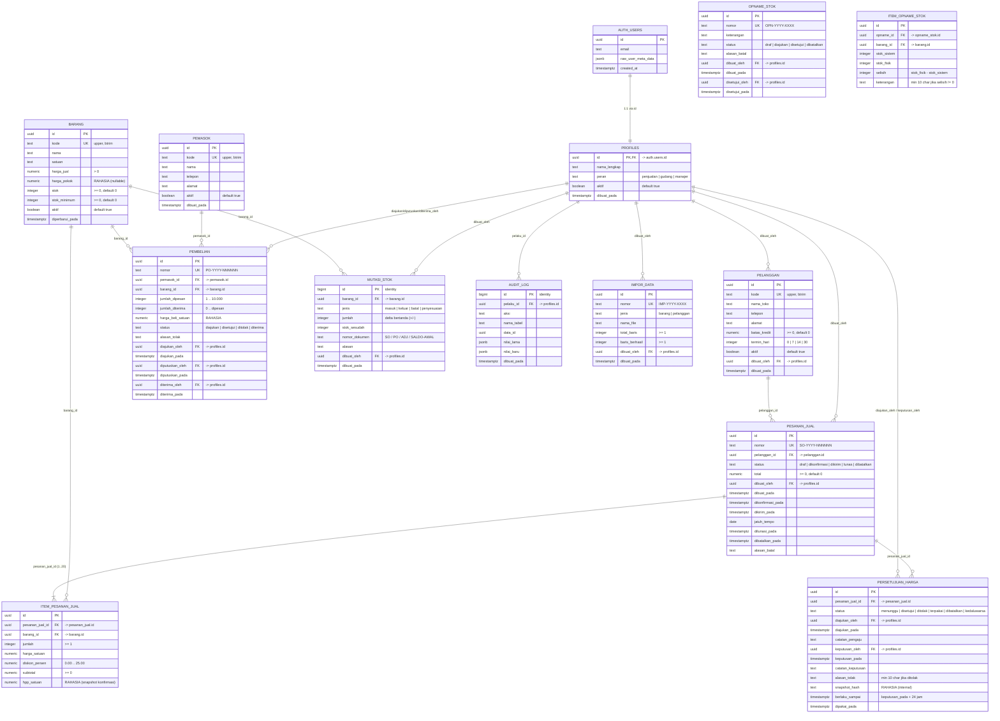

# 05 — Skema Database & Lapisan Keamanan

Dokumen ini memuat Entity Relationship Diagram (ERD) dan ringkasan arsitektur keamanan database untuk CV Sinar Abadi Niaga (Tahap 2).

Rujukan: [00-spesifikasi.md](00-spesifikasi.md), [02-matriks-akses.md](02-matriks-akses.md), [04-asumsi-dan-celah.md](04-asumsi-dan-celah.md).

---

## 1. Entity Relationship Diagram (ERD)

---

## 2. Ringkasan Lapisan Keamanan Pertahanan Berlapis (Defense in Depth)

Sistem database menerapkan 7 lapisan perlindungan mandiri di level Postgres:

| No | Lapisan | Mekanisme & Penegakan | Aturan yang Ditegakkan |
|---|---|---|---|
| **1** | **Jaringan & Auth** | Public sign-up dimatikan, semua akses API mewajibkan token JWT dari `auth.users`. Role `anon` dicabut seluruh izinnya (`REVOKE ALL`). | Akses ilegal anonim ditolak seketika (TC-01). |
| **2** | **Column-Level Grants (CG)** | Hak akses `SELECT` ke `authenticated` diberikan secara eksplisit per kolom. Kolom rahasia (`barang.harga_pokok`, `pembelian.harga_beli_satuan`, `item_pesanan_jual.hpp_satuan`) sama sekali tidak di-grant. UPDATE pada `barang.stok` dan `barang.kode` juga tidak di-grant. | Non-manajer tidak dapat membaca data rahasia melalui query apa pun (`permission denied`, TC-03, TC-05). |
| **3** | **Row-Level Security (RLS)** | RLS aktif di seluruh 11 tabel. Kebijakan menggunakan fungsi helper aman `public.fn_peran()` (SECURITY DEFINER, STABLE). Staf Penjualan hanya membaca pesanan miliknya sendiri, Gudang hanya membaca pesanan non-draf, Manajer membaca seluruh baris, dan `audit_log` hanya dapat dibaca Manajer. | Isolasi data horizontal antar peran dan staf penjualan (TC-04, TC-06, TC-28, TC-41..48). |
| **4** | **Trigger Guards (TG)** | Trigger `BEFORE UPDATE OR DELETE` memblokir perubahan kolom terlarang berdasarkan peran: perubahan `harga_jual` & `harga_pokok` hanya Manajer; perubahan `batas_kredit` & `termin_hari` hanya Manajer; perubahan `peran` & `aktif` hanya Manajer. Perubahan `barang.stok` langsung diblokir kecuali flag sesi transaksi `app.mutasi_stok = '1'` aktif. Tabel `mutasi_stok` dan `audit_log` dijaga bersifat *append-only*. | Menjamin integritas stok (BR-01, TC-08) dan mencegah eskalasi wewenang (TC-06, TC-09, TC-18, TC-27, TC-28). |
| **5** | **Views Khusus & Security Barrier** | **View Publik** (`v_barang`, `v_pembelian`, `v_item_pesanan_jual`, `v_pelanggan_piutang`, `v_pelanggan_kredit`) mengecualikan kolom rahasia dan memasang `security_invoker = true`. **View Manajer** (`v_barang_manajer`, `v_pembelian_manajer`, `v_item_pesanan_jual_manajer`, `v_opname_stok_manajer`) menyertakan kolom rahasia dan berjalan dengan hak pemilik (BUKAN `security_invoker`), wajib memasang `WITH (security_barrier = true)` dan klausa `WHERE public.fn_is_manajer() = true`. | Non-manajer yang memanggil view manajer selalu menerima 0 baris secara deterministik dan anti-leak optimizer (TC-04, TC-48, K1). |
| **6** | **Database Constraints (CK)** | Validasi ketat di level kolom: `harga_jual > 0`, `stok >= 0`, `stok_minimum >= 0` (BR-01); `jumlah >= 1`, `UNIQUE(pesanan_jual_id, barang_id)`, `diskon_persen 0..25`, `subtotal >= 0` (BR-02, BR-03); `termin_hari IN (0,7,14,30)`, `batas_kredit >= 0` (BR-05); `jumlah_dipesan 1..10000`, `jumlah_diterima <= jumlah_dipesan` (BR-09); `stok_fisik >= 0`, `UNIQUE(opname_id, barang_id)`. | Tidak ada data cacat yang bisa masuk meskipun aplikasi memiliki bug logika. |
| **7** | **Audit Logging Otomatis** | Trigger `AFTER UPDATE` mencatat perubahan sensitif (`barang.harga_jual`, `pelanggan.batas_kredit`, `pelanggan.termin_hari`, `profiles.peran`, `profiles.aktif`) ke `audit_log` secara otomatis dan permanen (append-only). | Jejak audit akuntabel dan tidak bisa dipalsukan (BR-12, TC-28). |

---

## 3. Daftar File Migrasi Supabase

| File | Tujuan Utama |
|---|---|
| `supabase/migrations/20261021120000_helpers.sql` | Helper roles, `auth.uid()`, `fn_peran()`, `peran_saya()`, `fn_is_manajer()`. |
| `supabase/migrations/20261021120100_skema_inti.sql` | Sequences nomor dokumen, 9 tabel inti, CHECK constraints, UNIQUE, FK, normalisasi kode, dan trigger `handle_new_user`. |
| `supabase/migrations/20261021120200_trigger_guard.sql` | Guard stok barang (`app.mutasi_stok`), pembatasan kolom per peran, guard append-only, dan trigger audit log. |
| `supabase/migrations/20261021120300_views.sql` | View publik (`security_invoker = true`) & view manajer (`fn_is_manajer()` filter). |
| `supabase/migrations/20261021120400_grants.sql` | Column-level grants, pencabutan hak akses kolom rahasia, izin sequence dan view. |
| `supabase/migrations/20261021120500_rls.sql` | Pengaktifan RLS dan pembuatan security policy pada seluruh 9 tabel. |
| `supabase/migrations/20261021120600_rpc.sql` | 18 RPC alur transaksi dan pengelolaan master data. |
| `supabase/migrations/20261021130000_rpc_laporan_tambahan.sql` | RPC agregat laporan analitik omzet, margin, dan aging piutang khusus Manajer. |
| `supabase/migrations/20261021140000_kredit_overdue.sql` | Modul Limit Kredit Dinamis & Blokir Otomatis: `fn_hitung_kredit_pelanggan`, view `v_pelanggan_kredit`, pembaruan `v_pelanggan_piutang`, `rpc_get_kredit_pelanggan`, `rpc_get_faktur_overdue_pelanggan`, serta pembaruan `rpc_konfirmasi_pesanan`. |
| `supabase/migrations/20261022000000_stock_opname.sql` | Modul Stock Opname & Penyesuaian Fisik Gudang: tabel `opname_stok`, `item_opname_stok`, RLS, sequences, dan 5 RPC opname. |
| `supabase/migrations/20261022110000_perbaikan_audit.sql` | Resolusi Temuan Audit (K1 s.d. K4): `v_opname_stok_manajer` owner rights + `security_barrier = true`, penghapusan prefix usang `E0006`/`E0007` pada `rpc_konfirmasi_pesanan`, validasi keterangan selisih $\ge 10$ char (`E0037`), pengaman anti-drift stok berubah (`E0038`), dan format alasan kartu stok `"Stock opname <nomor>: <keterangan>"`. |
| `supabase/migrations/20261022200000_persetujuan_harga.sql` | Alur Persetujuan Harga di Bawah HPP: tabel `persetujuan_harga`, partial unique index aktif, hash snapshot pesanan, view publik `v_persetujuan_harga` & owner `v_persetujuan_harga_manajer`, RPC ajukan/putuskan/batalkan, serta pembaruan `rpc_konfirmasi_pesanan`, `rpc_simpan_draf_pesanan`, `rpc_batalkan_draf` dengan urutan kunci baris bebas deadlock. |
| `supabase/migrations/20261022210000_penagihan_piutang.sql` | Modul Penagihan Piutang dan Pengingat Jatuh Tempo: tabel `catatan_penagihan` (append-only), trigger guard `trg_catatan_penagihan_guard` (E0051), fungsi `fn_klasifikasi_tagihan` (Asia/Jakarta), view `v_tagihan` (security invoker/RBAC filter), serta RPC `rpc_catat_penagihan` & `rpc_baca_catatan_penagihan`. |
| `supabase/migrations/20261023023000_impor_csv.sql` | Modul Impor CSV Data Awal Barang & Pelanggan: tabel `impor_data`, sequence `seq_impor_data`, trigger guard append-only, RLS khusus Manajer, dan RPC otoritatif `rpc_impor_barang` & `rpc_impor_pelanggan` (mutasi saldo awal resmi & audit ringkas). |
| `supabase/seed.sql` | Data seed: 5 akun uji dev (3 peran), 2 pemasok, 5 pelanggan, 15 barang (sebagian stok menipis), saldo awal kartu stok. |
| `supabase/tests/02_keamanan.sql` | Suite uji SQL 20 skenario mencakup RBAC, column grants, trigger guard, append-only, dan penolakan anon. |
| `supabase/tests/03_rpc.sql` | Suite uji SQL 25 skenario alur transaksi bisnis, invarian stok, batas kredit, dan konkurensi. |
| `supabase/tests/04_kredit_overdue.sql` | Suite uji SQL TC-29 s.d. TC-38: kalkulasi sisa kredit, prioritas D4, blokir overdue, non-bypassable, dan zero leakage. |
| `supabase/tests/05_stock_opname.sql` | Suite uji SQL TC-41 s.d. TC-54: stock opname, penyesuaian fisik, kerahasiaan view manajer, validasi selisih 10 char, pengaman anti-drift, dan tanggal bisnis Asia/Jakarta. |
| `supabase/tests/06_persetujuan_harga.sql` | Suite uji SQL TC-55 s.d. TC-70: 15 skenario pengujian lengkap alur persetujuan harga, validasi RBAC, BR-04, hash drift, 24 jam expiry, zero leakage, dan cascading draf. |
| `supabase/tests/06_konkurensi_persetujuan.ps1` | Suite uji konkurensi PowerShell (TC-67): 10 iterasi eksekusi paralel simultan konfirmasi pesanan vs persetujuan harga (bebas deadlock). |
| `supabase/tests/07_penagihan_piutang.sql` | Suite uji SQL TC-71 s.d. TC-83 & TC-88: 14 skenario batas klasifikasi umur (hari ini, segera, belum tempo, overdue 1-7, 8-30, >30), isolasi RLS Penjualan, blokir total Gudang, sifat append-only catatan penagihan, validasi tanggal janji bayar, dan hilangnya faktur lunas dari tagihan. |
| `supabase/tests/08_impor_csv.sql` | Suite uji SQL TC-89 s.d. TC-108: 20 skenario lengkap validasi otoritas Manajer, atomisitas impor barang & pelanggan, penolakan duplikat DB / file, integritas kartu stok awal, isolasi RLS, penolakan bypass langsung, dan zero leakage data rahasia. |
