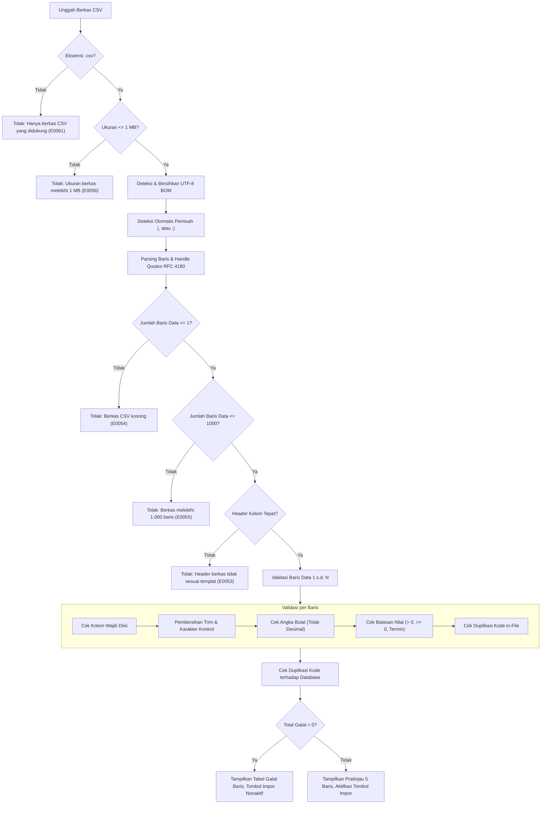

# Spesifikasi Implementasi: Impor CSV Barang dan Pelanggan
**Fitur Enterprise — Alur Impor Massal Data Master dengan Validasi Dry-Run & Eksekusi Atomik**  
*Status: Perancangan (Draf Spesifikasi Teknis Otoritatif) — Disusun oleh Tech Lead*  
*Rujukan: [AGENTS.md](../AGENTS.md), [docs/00-spesifikasi.md](00-spesifikasi.md), [docs/02-matriks-akses.md](02-matriks-akses.md), [docs/03-test-plan.md](03-test-plan.md), [docs/04-asumsi-dan-celah.md](04-asumsi-dan-celah.md), [docs/05-skema.md](05-skema.md), [docs/16-peta-sistem-saat-ini.md](16-peta-sistem-saat-ini.md).*

---

## 1. Audit Kondisi Saat Ini & Analisis Kesenjangan

Berikut adalah hasil audit mendalam terhadap seluruh berkas migrasi database (`supabase/migrations/`), skrip trigger guard, fungsi RPC, dan kode sumber frontend (`src/`) terkait kebutuhan fitur impor CSV:

| Kebutuhan Fitur | Sudah Ada? | Lokasi Saat Ini | Kesenjangan & Penyesuaian yang Diperlukan |
|---|:---:|---|---|
| **Otorisasi Khusus Manajer (I1)** | Sebagian | `src/lib/akses.ts`, `profiles.peran` | Rute `/impor` dan `/impor/riwayat` belum terdaftar di `MENU_ITEMS` dan `ROUTE_PERMISSIONS`. Perlu menambahkan menu di bawah section `Administrasi Sistem` khusus Manajer. |
| **Dukungan Berkas CSV & Delimiter (I2)** | Belum | Tidak ada | Belum ada utilitas parser CSV murni di frontend yang mendukung deteksi otomatis pemisah koma `,` vs titik koma `;`, penanganan UTF-8 BOM, dan limit 1 MB / 1.000 baris. |
| **Validasi Skema Kolom (I3, I4)** | Sebagian | Zod schemas di master data | Skema Zod saat ini hanya menangani form entri tunggal web (`buatBarangSchema`, `buatPelangganSchema`). Diperlukan skema parser batch CSV dengan normalisasi string ribuan dan penolakan keras desimal. |
| **Kebijakan Insert-Only / No-Upsert (I5)** | Belum | `rpc_buat_barang`, `rpc_buat_pelanggan` | Belum ada pengecekan massal (*batch in-memory + database pre-check*) untuk memastikan seluruh kode dalam berkas bersifat baru dan unik. |
| **Transaksi Atomik All-or-Nothing (I6, I9)** | Belum | Tidak ada | Belum ada RPC transaksi tunggal yang memproses sekumpulan data barang/pelanggan secara atomik dengan rollback menyeluruh jika ada 1 baris gagal. |
| **Jalur Mutasi Stok Saldo Awal (I7)** | Sudah Ada | `trg_barang_guard`, `mutasi_stok` | Trigger guard `trg_barang_guard` memblokir update stok langsung tanpa flag sesi `app.mutasi_stok = '1'`. RPC impor wajib mengaktifkan flag ini dan mencatat buku besar `mutasi_stok` jenis `penyesuaian` dengan alasan $\ge 10$ karakter (`Impor stok awal <nomor_impor>`). |
| **Jalur Harga Pokok Manajer (I7)** | Sudah Ada | `trg_barang_guard`, `rpc_set_harga_pokok` | `harga_pokok` pada barang baru dapat diisi saat `INSERT` oleh Manajer (`fn_is_manajer()`). Riwayat audit log tidak boleh memuat nominal HPP baris mentah. |
| **Tabel Riwayat Impor (I8)** | Belum | Tidak ada | Belum ada tabel `public.impor_data` dan sequence `seq_impor_data` untuk nomor dokumen `IMP-YYYY-XXXX`. |
| **Pencegahan Kebocoran Data Rahasia (I10)** | Sudah Ada | Matriks Akses, Column Grants | `v_barang` dan respons API non-manajer mencabut kolom rahasia. Hasil impor dan tabel riwayat wajib diisolasi dari data HPP. |
| **Pengunduhan Templat CSV (I11)** | Belum | Tidak ada | Belum ada API route / server utility untuk mengunduh berkas templat CSV resmi bertanda header yang tepat dan data contoh dummy yang valid. |
| **Katalog Kode Error (I13)** | Sebagian | `src/lib/errors.ts` (E0001–E0052) | Kode bebas berikutnya dimulai dari **E0053** s.d. **E0062** untuk memetakan galat berkas dan galat baris CSV. |

---

## 2. Ringkasan Keputusan Desain (I1 s.d. I13)

Sesuai instruksi dan kesepakatan arsitektur sistem, 13 keputusan otoritatif berikut berlaku mutlak tanpa penafsiran ulang:

- **I1 (Tiga Lapis Otorisasi Manajer):** Fitur impor data hanya dapat diakses oleh peran **Manajer**. Ditegakkan pada tiga lapisan: (1) Rute UI `/impor` dialihkan ke `/tidak-berwenang` untuk non-Manajer via `middleware.ts` & `src/lib/akses.ts`; (2) Server Action memeriksa sesi profil pengguna `profile.peran === 'manajer'`; (3) Fungsi RPC database memverifikasi `public.fn_is_manajer()` di baris pertama eksekusi.
- **I2 (Format Berkas CSV & Limitasi):** Hanya menerima berkas berekstensi `.csv` dengan encoding UTF-8 (dengan atau tanpa BOM). Sistem mendeteksi otomatis pemisah koma (`,`) atau titik koma (`;`). Batas maksimal ukuran berkas adalah **1 MB** dan maksimal **1.000 baris data** (di luar header). Berkas `.xlsx` atau format biner lainnya ditolak tegas dengan pesan instruksi yang jelas.
- **I3 (Spesifikasi Header Kolom):**
  - **Barang (8 kolom):** `kode,nama,satuan,harga_jual,harga_pokok,stok_minimum,stok_awal,aktif`
    - Kolom Wajib: `kode`, `nama`, `satuan`, `harga_jual`, `stok_minimum`.
    - Kolom Opsional: `harga_pokok` (boleh kosong), `stok_awal` (default 0), `aktif` (default benar/true).
  - **Pelanggan (6 kolom):** `kode,nama_toko,telepon,alamat,termin_hari,batas_kredit`
    - Kolom Wajib: `kode`, `nama_toko`.
    - Kolom Opsional: `telepon` (boleh kosong), `alamat` (boleh kosong), `termin_hari` (default 0, opsi: 0, 7, 14, 30), `batas_kredit` (default 0).
  - *Aturan Header:* Nama kolom bersifat *case-insensitive* setelah normalisasi trim. Jika header tidak sesuai, kolom wajib hilang, atau terdapat kolom asing yang tidak dikenal, seluruh berkas ditolak seketika (*file-level rejection*).
- **I4 (Pembersihan Teks & Validasi Angka Ketat):**
  - Teks dibersihkan dari spasi luar (`trim`) dan karakter kontrol non-cetak. Panjang karakter dibatasi: `kode` (2–50 char), `nama`/`nama_toko` (3–200 char), `satuan` (1–20 char).
  - Nilai moneter dan kuantitas hanya menerima bilangan bulat (*integer*). Pemisah ribuan titik (`.`) atau koma (`,`) dibersihkan secara ketat. Angka desimal (mengandung pecahan seperti `10000.50` atau `10000,5`) **ditolak keras**.
  - Nilai valid: `harga_jual > 0`, `harga_pokok >= 0` (jika diisi), `stok_minimum >= 0`, `stok_awal >= 0`, `batas_kredit >= 0`.
- **I5 (Kebijakan Insert-Only / Tanpa Upsert):** Impor hanya diperuntukkan bagi pembuatan data master baru. Jika ditemukan kode barang atau kode pelanggan yang sudah terdaftar di database, baris tersebut ditandai sebagai galat. Tidak ada pembaruan data otomatis (*no upsert*).
- **I6 (Atomisitas Transaksi - All or Nothing):** Jika terdapat **minimal satu galat** pada baris data mana pun, tombol eksekusi "Impor Sekarang" dinonaktifkan secara otomatis. Manajer wajib memperbaiki berkas CSV dan mengunggah ulang. Saat valid, seluruh baris diproses dalam satu transaksi database PostgreSQL tunggal.
- **I7 (Jalur Resmi Mutasi Stok Saldo Awal):** Barang dengan `stok_awal > 0` tidak boleh memanipulasi kolom `barang.stok` secara langsung. Prosedur RPC wajib:
  1. Memasukkan data master barang dengan nilai `stok = 0`.
  2. Mengaktifkan flag sesi transaksional `PERFORM set_config('app.mutasi_stok', '1', true)`.
  3. Memperbarui `barang.stok = stok_awal`.
  4. Mencatat kartu stok `public.mutasi_stok` bertipe `'penyesuaian'`, jumlah sebesar `stok_awal`, `stok_sesudah = stok_awal`, nomor dokumen berupa nomor impor (`IMP-YYYY-XXXX`), dan alasan berformat persis: `'Impor stok awal ' || v_nomor_impor` ($\ge 10$ karakter, memenuhi BR-11).
  5. Pengisian `harga_pokok` dicatat resmi pada entitas barang oleh Manajer.
- **I8 (Tabel Riwayat `impor_data` & Rekaman Audit Ringkasan):** Dibuat tabel `public.impor_data` untuk mencatat metadata impor. **Dilarang keras menyimpan isi baris data mentah, harga pokok, atau isi berkas fisik di tabel basis data, audit log, maupun log server aplikasi.** Tabel `public.audit_log` hanya merekam satu entri ringkasan per sesi impor sukses.
- **I9 (Validasi Dua Lapisan - Server Action & RPC Database):**
  - *Lapisan Server Action:* Melakukan parsing stream CSV, validasi skema Zod, deteksi duplikasi in-memory, dan validasi duplikasi database untuk menghasilkan tabel pratinjau kering (*dry-run preview*).
  - *Lapisan RPC Database:* Menerima payload tervalidasi berupa JSONB dan **memvalidasi ulang seluruh aturan bisnis di tingkat database engine** (*Zero-Trust Server Action*). Menangani balapan konkurensi antar pengguna melalui *unique constraint exception trapping*.
- **I10 (Zero-Leakage Finansial pada Pratinjau):** Pratinjau kering yang memuat kolom `harga_pokok` hanya dapat diakses melalui Server Action terproteksi sesi Manajer dengan header HTTP `Cache-Control: no-store, private`. Data pratinjau tidak disimpan ke database.
- **I11 (Templat CSV Resmi Siap Unduh):** Menyediakan endpoint unduh berkas templat CSV untuk Barang dan Pelanggan. Templat berisi baris header baku dan 2 baris data contoh fiktif yang valid.
- **I12 (Antarmuka Riwayat Impor `/impor/riwayat`):** Halaman riwayat menyajikan tabel padat (*dense data-table*) berisi: Nomor Dokumen Impor, Jenis, Nama Berkas Asli, Jumlah Baris, Jumlah Dibuat, Status, Waktu Eksekusi, dan Nama Manajer Pelaksana.
- **I13 (Katalog Kode Error Khusus Impor):** Seluruh pesan kegagalan validasi menggunakan katalog kode error terpusat (`E0053` s.d. `E0062`) dalam Bahasa Indonesia yang ramah pengguna, menyebutkan nomor baris data dan nama kolom secara presisi tanpa membocorkan data internal basis data.

---

## 3. Aturan Bisnis Baru (Business Rules)

Fitur ini memperluas katalog aturan bisnis resmi sistem CV Sinar Abadi Niaga:

- **BR-25 (Otorisasi Akses Fitur Impor):**
  Halaman `/impor`, endpoint templat, dan fungsi RPC impor hanya dapat diakses oleh akun aktif dengan peran Manajer. Staf Penjualan dan Staf Gudang diblokir total pada level rute, Server Action, dan RPC basis data (`E0001`).
- **BR-26 (Integritas Format Berkas CSV):**
  Berkas impor wajib berekstensi `.csv` dengan ukuran $\le 1\text{ MB}$ dan jumlah baris data antara 1 s.d. 1.000 baris. Berkas dengan ekstensi selain `.csv` (termasuk `.xlsx` dan `.xls`), berkas kosong (0 baris), atau berkas yang melebihi batas kuota ditolak seketika pada tingkat berkas.
- **BR-27 (Validasi Struktur Header & Kolom Wajib):**
  Baris pertama berkas wajib memuat header kolom yang cocok persis dengan spesifikasi templat resmi. Jika header tidak sesuai, kolom wajib tidak ditemukan, atau terdapat kolom tak dikenal, seluruh berkas ditolak (`E0053`).
- **BR-28 (Ketunggalan Kode & Kebijakan Insert-Only):**
  Setiap kode barang atau pelanggan wajib unik di dalam berkas CSV (tidak boleh ganda) dan belum pernah terdaftar sebelumnya di database. Jika kode telah ada di database, baris ditolak sebagai galat duplikasi (`E0057`). Sistem tidak menyediakan mekanisme *upsert* atau penimpaan data lama.
- **BR-29 (Integritas Angka & Larangan Pecahan Desimal):**
  Seluruh kolom numerik (`harga_jual`, `harga_pokok`, `stok_minimum`, `stok_awal`, `termin_hari`, `batas_kredit`) hanya menerima bilangan bulat positif atau nol. Angka yang mengandung pecahan desimal atau karakter alfabet ditolak sebagai galat format angka (`E0058`).
- **BR-30 (Atomisitas Eksekusi Impor - All or Nothing):**
  Jika berkas CSV mengandung $\ge 1$ baris galat, eksekusi impor diblokir. Apabila seluruh baris valid, proses impor dijalankan dalam satu transaksi atomik. Jika terjadi kegagalan sistem atau pelanggaran constraint saat proses penulisan basis data, seluruh operasi di-rollback penuh tanpa ada data parsial yang tersimpan.
- **BR-31 (Invarian Mutasi Saldo Awal Kartu Stok):**
  Pencatatan barang baru dengan `stok_awal > 0` wajib memicu pembuatan rekaman kartu stok `mutasi_stok` bertipe `'penyesuaian'` dengan alasan berformat `'Impor stok awal ' || nomor_impor` ($\ge 10$ karakter), nomor dokumen `IMP-YYYY-XXXX`, dan menjamin invarian $\sum \text{mutasi\_stok.jumlah} = \text{barang.stok}$.
- **BR-32 (Zero-Leakage & Ringkasan Jejak Audit Impor):**
  Isi baris berkas mentah, berkas fisik CSV, dan nominal `harga_pokok` dilarang disimpan ke dalam tabel `impor_data` maupun tabel `audit_log`. Entri audit log untuk transaksi impor hanya mencatat metadata ringkasan jumlah baris yang berhasil dibuat.

### Verifikasi Ketiadaan Konflik dengan BR-01 s.d. BR-12

| Aturan Eksisting | Status Interaksi | Analisis & Jaminan Ketiadaan Konflik |
|---|:---:|---|
| **BR-01 (Integritas Stok & Harga Jual)** | **Dipatuhi Penuh** | `harga_jual > 0` dan `stok_minimum >= 0` divalidasi ketat. Perubahan stok fisik awal hanya dilakukan lewat jalur mutasi resmi bertransaksi `mutasi_stok`, bukan update langsung ke `barang.stok`. |
| **BR-02 s.d. BR-04 (Pesanan Jual & HPP)** | **Tidak Terdampak** | Modul impor tidak membuat pesanan jual. Barang hasil impor otomatis memiliki harga jual dan harga pokok yang siap digunakan pada alur pesanan jual eksisting. |
| **BR-05 (Batas Kredit & Termin)** | **Dipatuhi Penuh** | Batas kredit pelanggan baru hanya dapat diisi melalui impor oleh Manajer (sesuai hak istimewa Manajer). `termin_hari` divalidasi ketat hanya menerima nilai `0, 7, 14, 30`. |
| **BR-06 s.d. BR-10 (PO & Alur Status)** | **Tidak Terdampak** | Tidak ada modifikasi alur pembelian atau status faktur. |
| **BR-11 (Buku Besar Mutasi Stok)** | **Dipatuhi Penuh** | Setiap saldo awal yang dimasukkan dicatat di `public.mutasi_stok` jenis `'penyesuaian'` lengkap dengan alasan $\ge 10$ karakter, menjaga rekonsiliasi total stok fisik. |
| **BR-12 (Audit Log Aksi Sensitif)** | **Dipatuhi Penuh** | Aksi impor dicatat resmi ke dalam `public.audit_log` sebagai entri ringkasan tunggal tanpa membocorkan data rahasia HPP. |

---

## 4. Perubahan Skema Basis Data

### A. Sequence Nomor Dokumen Impor
Nomor dokumen impor mengikuti pola resmi sistem distributor: `IMP-YYYY-XXXX` (contoh: `IMP-2026-0001`).
```sql
CREATE SEQUENCE IF NOT EXISTS public.seq_impor_data START 1 INCREMENT 1 NO CYCLE;
```

### B. Tabel `public.impor_data`
```sql
CREATE TABLE IF NOT EXISTS public.impor_data (
  id uuid PRIMARY KEY DEFAULT gen_random_uuid(),
  nomor text NOT NULL UNIQUE,
  jenis text NOT NULL CHECK (jenis IN ('barang', 'pelanggan')),
  nama_berkas text NOT NULL,
  jumlah_baris integer NOT NULL CHECK (jumlah_baris >= 1 AND jumlah_baris <= 1000),
  jumlah_dibuat integer NOT NULL CHECK (jumlah_dibuat >= 0 AND jumlah_dibuat <= jumlah_baris),
  status text NOT NULL CHECK (status IN ('berhasil', 'gagal')),
  ringkasan jsonb NOT NULL DEFAULT '{}'::jsonb,
  dibuat_oleh uuid NOT NULL REFERENCES public.profiles(id),
  dibuat_pada timestamptz NOT NULL DEFAULT now()
);

-- Indeks performa pencarian & audit
CREATE INDEX IF NOT EXISTS idx_impor_data_dibuat_pada ON public.impor_data (dibuat_pada DESC);
CREATE INDEX IF NOT EXISTS idx_impor_data_jenis ON public.impor_data (jenis);
```

### C. Keamanan RLS & Column Grants
```sql
-- 1. Cabut hak dari publik dan anon
REVOKE ALL ON public.impor_data FROM anon, public;

-- 2. Aktifkan RLS
ALTER TABLE public.impor_data ENABLE ROW LEVEL SECURITY;

-- 3. Kebijakan Baca: Hanya Manajer
CREATE POLICY impor_data_select_manajer ON public.impor_data
  FOR SELECT TO authenticated
  USING (public.fn_is_manajer() = true);

-- 4. Blokir Modifikasi Langsung (Insert/Update/Delete hanya lewat RPC internal)
CREATE POLICY impor_data_modify_block ON public.impor_data
  FOR ALL TO authenticated
  USING (false)
  WITH CHECK (false);

-- 5. Grant hak akses
GRANT SELECT ON public.impor_data TO authenticated;
GRANT USAGE, SELECT ON SEQUENCE public.seq_impor_data TO authenticated;
```

### D. Kontrak Fungsi Database (RPC)

#### 1. RPC `public.rpc_impor_barang`
* **Definisi:** `SECURITY DEFINER`, `SET search_path = public, pg_temp`.
* **Parameter:**
  - `p_nama_berkas text`: Nama berkas CSV asli dari klien.
  - `p_items jsonb`: Array objek barang yang telah lolos validasi struktur.
* **Format Kontrak JSONB `p_items`:**
  ```json
  [
    {
      "kode": "BRG-X01",
      "nama": "Gula Pasir Kristal 1kg",
      "satuan": "kg",
      "harga_jual": 16500,
      "harga_pokok": 14000,
      "stok_minimum": 10,
      "stok_awal": 50,
      "aktif": true
    }
  ]
  ```
* **Logika Eksekusi Transaksional:**
  1. Validasi pemanggil: wajib `public.fn_is_manajer()`, tolak `E0001` jika bukan.
  2. Validasi jumlah baris: `jsonb_array_length(p_items)` antara 1 s.d. 1.000, tolak `E0054` jika kosong atau `E0055` jika melebihi kuota.
  3. Generate nomor dokumen: `format('IMP-%s-%s', to_char((now() AT TIME ZONE 'Asia/Jakarta')::date, 'YYYY'), lpad(nextval('public.seq_impor_data')::text, 4, '0'))`.
  4. Periksa duplikasi database: jika ada item dengan kode yang sudah ada di tabel `public.barang`, lempar `E0057`.
  5. Loop insert master barang (`public.barang`) dengan `stok = 0`.
  6. Jika `stok_awal > 0`:
     - Set setting sesi: `PERFORM set_config('app.mutasi_stok', '1', true)`.
     - Update `stok = item.stok_awal` pada baris barang tersebut.
     - Insert ke `public.mutasi_stok` (jenis: `'penyesuaian'`, jumlah: `item.stok_awal`, `stok_sesudah`: `item.stok_awal`, nomor dokumen: `v_nomor_impor`, alasan: `'Impor stok awal ' || v_nomor_impor`, dibuat_oleh: `auth.uid()`).
  7. Catat entri ke `public.impor_data` dengan `status = 'berhasil'` dan ringkasan kuantitas.
  8. Catat entri tunggal ke `public.audit_log`: aksi `'impor_barang'`, nama tabel `'impor_data'`, data id `v_impor_id`, nilai baru `jsonb_build_object('nomor', v_nomor_impor, 'jumlah_baris', v_total_baris, 'stok_awal_count', v_stok_count)`.
  9. Return JSON respon sukses: `{ "sukses": true, "nomor": "IMP-2026-0001", "jumlah_dibuat": 15 }`.

#### 2. RPC `public.rpc_impor_pelanggan`
* **Definisi:** `SECURITY DEFINER`, `SET search_path = public, pg_temp`.
* **Parameter:**
  - `p_nama_berkas text`: Nama berkas CSV asli.
  - `p_items jsonb`: Array objek pelanggan.
* **Format Kontrak JSONB `p_items`:**
  ```json
  [
    {
      "kode": "PLG-X01",
      "nama_toko": "Toko Barokah Jaya",
      "telepon": "081298765432",
      "alamat": "Jl. Kaliabang No. 12, Bekasi Utara",
      "termin_hari": 14,
      "batas_kredit": 5000000,
      "aktif": true
    }
  ]
  ```
* **Logika Eksekusi Transaksional:**
  1. Validasi pemanggil: wajib `public.fn_is_manajer()`, tolak `E0001` jika bukan.
  2. Validasi jumlah baris: antara 1 s.d. 1.000.
  3. Generate nomor dokumen: `IMP-YYYY-XXXX`.
  4. Periksa duplikasi database pada tabel `public.pelanggan`, tolak `E0057` jika sudah terdaftar.
  5. Validasi `termin_hari IN (0, 7, 14, 30)` dan `batas_kredit >= 0`.
  6. Loop insert master pelanggan (`public.pelanggan`) dengan `dibuat_oleh = auth.uid()`.
  7. Catat ke `public.impor_data` dan buat entri ringkasan di `public.audit_log`.
  8. Return JSON respon sukses: `{ "sukses": true, "nomor": "IMP-2026-0002", "jumlah_dibuat": 20 }`.

---

## 5. Algoritma Parsing & Validasi (Dry-Run Engine)

Sistem menggunakan mesin parsing murni yang terisolasi di `src/features/impor/utils.ts` sehingga dapat diuji secara komprehensif menggunakan Vitest tanpa dependensi jaringan.



### A. Urutan Validasi & Pemetaan Galat

| Urutan Langkah | Target Evaluasi | Kondisi Gagal | Kode Galat | Pesan Galat Resmi |
|:---:|---|---|:---:|---|
| **1** | Format Berkas | Ekstensi file bukan `.csv` (misal `.xlsx`, `.txt`) | `E0061` | Hanya berkas berekstensi .csv yang didukung. Berkas Excel (.xlsx) tidak didukung. |
| **2** | Ukuran Berkas | File size $> 1.048.576\text{ byte}$ ($1\text{ MB}$) | `E0056` | Ukuran berkas CSV melebihi batas maksimal 1 MB |
| **3** | Baris Data | Baris data (selain header) $= 0$ baris | `E0054` | Berkas CSV kosong, tidak ada data untuk diimpor |
| **4** | Baris Data | Baris data $> 1.000$ baris | `E0055` | Berkas CSV melebihi batas maksimal 1.000 baris data |
| **5** | Header Berkas | Header tidak lengkap, salah ketik, atau ada kolom asing | `E0053` | Header kolom tidak sesuai templat resmi |
| **6** | Baris: Kolom Wajib | Kolom wajib (`kode`, `nama`/`nama_toko`, dll.) kosong setelah trim | `E0002` | Baris {baris}: Kolom {kolom} wajib diisi |
| **7** | Baris: Format Angka | Mengandung pecahan desimal (titik/koma desimal) atau huruf | `E0058` | Baris {baris}: Kolom {kolom} harus berupa bilangan bulat tanpa pecahan desimal |
| **8** | Baris: Harga Jual | Nilai `harga_jual <= 0` | `E0028` | Baris {baris}: Harga jual harus lebih dari 0 |
| **9** | Baris: Stok / Batas | `stok_minimum < 0`, `stok_awal < 0`, atau `batas_kredit < 0` | `E0029` | Baris {baris}: Kolom {kolom} harus berupa bilangan bulat >= 0 |
| **10** | Baris: Termin Bayar | Nilai `termin_hari` bukan salah satu dari `0, 7, 14, 30` | `E0024` | Baris {baris}: Termin hari harus 0, 7, 14, atau 30 |
| **11** | Baris: Duplikasi File | Kode barang/pelanggan muncul lebih dari 1 kali dalam berkas | `E0059` | Baris {baris}: Kode '{kode}' duplikat di dalam berkas CSV ini |
| **12** | Baris: Duplikasi DB | Kode barang/pelanggan sudah terdaftar di database | `E0057` | Baris {baris}: Kode '{kode}' sudah terdaftar di sistem |

---

## 6. Desain Antarmuka Pengguna (UI)

Sesuai panduan **"Aturan UI"** dalam `AGENTS.md`, seluruh antarmuka modul impor menggunakan styling Tailwind CSS enterprise yang bersih, padat, dan konsisten dengan komponen bersama (`AppShell`, `PageHeader`, `DataTable`, `BadgeStatus`).

### A. Halaman Utama `/impor` (`src/app/(dashboard)/impor/page.tsx`)
1. **Header Halaman (`PageHeader`):**
   - Judul: `"Impor Data Master"`
   - Deskripsi: `"Masukkan data awal katalog barang dan pelanggan secara massal melalui berkas CSV."`
   - Aksi Kanan: Tombol sekunder tautan ke `"/impor/riwayat"` (ikon `History` / `Clock`).
2. **Tab Navigasi:**
   - Tab 1: `"Impor Barang"` (aktif secara default atau via query param `?tab=barang`).
   - Tab 2: `"Impor Pelanggan"` (via query param `?tab=pelanggan`).
3. **Kartu Panduan & Unduh Templat:**
   - Card putih `border-slate-200` padat.
   - Penjelasan ringkas kolom wajib dan format angka.
   - Tombol outline: `"Unduh Templat CSV Barang"` / `"Unduh Templat CSV Pelanggan"` yang mengunduh berkas `.csv` resmi.
4. **Area Dropzone Unggah Berkas:**
   - Kotak putus-putus (`border-dashed border-slate-300 hover:border-slate-400 bg-slate-50/50`).
   - Teks instruksi: *"Pilih atau seret berkas CSV ke sini (Maksimal 1 MB / 1.000 baris)"*.
   - Dukungan keyboard accessible (`Enter` / `Space` untuk membuka file picker).
5. **Panel Hasil Validasi (Dry-Run Preview):**
   - Muncul otomatis setelah berkas dipilih dan diproses oleh Server Action.
   - **Kartu Ringkasan Status:**
     - Total Baris: badge slate.
     - Baris Valid: badge emerald (`text-emerald-800 bg-emerald-50`).
     - Baris Galat: badge red (`text-red-800 bg-red-50`).
   - **Tabel Galat Baris (Jika Ada Galat):**
     - DataTable padat menampilkan: Nomor Baris, Nama Kolom, Nilai Bermasalah, dan Pesan Perbaikan.
     - Banner peringatan merah: *"Ditemukan {N} galat. Perbaiki berkas CSV Anda sebelum mengimpor. Tombol impor dinonaktifkan."*
   - **Tabel Pratinjau Data Valid (Maksimal 5 Baris Pertama):**
     - Menampilkan cuplikan data yang akan dibuat.
     - Khusus Barang: Kolom `Harga Pokok` hanya di-render untuk Manajer.
6. **Tombol Aksi Eksekusi:**
   - Tombol primer: `"Impor Sekarang ({N} Data Valid)"` (`bg-slate-900 text-white hover:bg-slate-800`).
   - Tombol dinonaktifkan (`disabled`) jika terdapat $\ge 1$ baris galat atau berkas belum dipilih.
   - Menampilkan status loading spinner saat transaksi database sedang berlangsung.
7. **Banner Keberhasilan:**
   - Setelah RPC selesai, menampilkan notifikasi sukses hijau memuat nomor dokumen `IMP-YYYY-XXXX` dan tautan cepat ke `/barang` atau `/pelanggan`.

### B. Halaman Riwayat Impor `/impor/riwayat` (`src/app/(dashboard)/impor/riwayat/page.tsx`)
1. **Header Halaman:**
   - Judul: `"Riwayat Impor Data"`
   - Tombol Aksi: Kembali ke `"/impor"`.
2. **DataTable Riwayat:**
   - Kolom:
     - Nomor Dokumen (`IMP-YYYY-XXXX`, font mono tebal).
     - Tanggal & Waktu (WIB / Asia/Jakarta).
     - Jenis Data (`Barang` / `Pelanggan` dengan badge).
     - Nama Berkas Asli.
     - Jumlah Baris.
     - Status (`Berhasil` badge emerald / `Gagal` badge red).
     - Pelaksana (Nama lengkap Manajer).
3. **Paginasi:** Menggunakan komponen `Pagination` terstandarisasi (15 baris per halaman).

### C. Integrasi Tombol Pintas pada Halaman Eksisting
- **Halaman `/barang`:** Di samping tombol `"Tambah Barang"`, ditambahkan tombol outline `"Impor CSV"` (hanya tampil jika `isManajer = true`) yang mengarah ke `/impor?tab=barang`.
- **Halaman `/pelanggan`:** Di samping tombol `"Tambah Pelanggan"`, ditambahkan tombol outline `"Impor CSV"` (hanya tampil jika `isManajer = true`) yang mengarah ke `/impor?tab=pelanggan`.

---

## 7. Perubahan Matriks Akses & Lapisan Penegak

| Modul / Rute / Objek | Penjualan | Gudang | Manajer | Lapisan Penegak Utama | Catatan Keamanan |
|---|:---:|:---:|:---:|---|---|
| **Halaman `/impor`** | ❌ 403 | ❌ 403 | ✅ Akses | Middleware, `src/lib/akses.ts`, Layout | Non-manajer dialihkan ke `/tidak-berwenang`. |
| **Halaman `/impor/riwayat`** | ❌ 403 | ❌ 403 | ✅ Akses | Middleware, `src/lib/akses.ts` | Non-manajer dialihkan ke `/tidak-berwenang`. |
| **Endpoint Unduh Templat** | ❌ Tolak | ❌ Tolak | ✅ Unduh | Server Route Handler + Session Check | Mengembalikan CSV dummy. |
| **Server Action Validasi & Impor** | ❌ E0001 | ❌ E0001 | ✅ Eksekusi | Server Action `getProfil()` peran check | Memverifikasi sesi JWT pengguna. |
| **RPC `rpc_impor_barang`** | ❌ E0001 | ❌ E0001 | ✅ Eksekusi | PostgreSQL `public.fn_is_manajer()` | Menolak tegas panggilan non-manajer. |
| **RPC `rpc_impor_pelanggan`** | ❌ E0001 | ❌ E0001 | ✅ Eksekusi | PostgreSQL `public.fn_is_manajer()` | Menolak tegas panggilan non-manajer. |
| **Tabel `impor_data`** | ❌ 0 baris | ❌ 0 baris | ✅ Baca | Row Level Security (RLS) | `fn_is_manajer() = true`. |
| **Sequence `seq_impor_data`** | ❌ Tolak | ❌ Tolak | ✅ USAGE | PostgreSQL Grants | Hanya dieksekusi melalui RPC. |

---

## 8. Katalog Kode Error Baru (`src/lib/errors.ts`)

Melanjutkan nomor error bebas berikutnya setelah `E0052`:

| Kode Error | Pesan Resmi di Katalog `ERROR_MESSAGES` | Komponen / Lapisan Pemicu | Skenario Pemunculan |
|---|---|---|---|
| **`E0053`** | `Header berkas CSV tidak sesuai dengan templat resmi` | Parser Server Action & RPC | Nama kolom di baris 1 tidak cocok atau ada kolom wajib yang hilang. |
| **`E0054`** | `Berkas CSV kosong, tidak ada data untuk diimpor` | Parser Server Action & RPC | Berkas hanya berisi header atau 0 baris data. |
| **`E0055`** | `Berkas CSV melebihi batas maksimal 1.000 baris data` | Parser Server Action & RPC | Jumlah baris data $> 1.000$. |
| **`E0056`** | `Ukuran berkas CSV melebihi batas maksimal 1 MB` | Server Action Upload | File size $> 1.048.576\text{ byte}$. |
| **`E0057`** | `Kode '{kode}' sudah terdaftar di sistem` | Validasi Database & RPC | Kode barang/pelanggan sudah ada di tabel database (kebijakan no-upsert). |
| **`E0058`** | `Nilai harus berupa bilangan bulat tanpa pecahan desimal` | Parser Server Action & RPC | Input angka mengandung desimal titik/koma (misal: `10000.50`). |
| **`E0059`** | `Kode '{kode}' duplikat di dalam berkas CSV` | Parser Server Action & RPC | Kode barang/pelanggan muncul berulang dalam berkas yang sama. |
| **`E0060`** | `Gagal memproses impor data, seluruh transaksi dibatalkan` | RPC Database | Terjadi kegagalan penulisan atau benturan konkurensi (all-or-nothing rollback). |
| **`E0061`** | `Format berkas tidak didukung, harap unggah berkas berekstensi .csv` | Server Action Upload | Pengguna mengunggah berkas selain CSV (seperti `.xlsx`). |
| **`E0062`** | `Data impor tidak valid` | RPC Database | Payload JSONB yang dikirim ke RPC tidak lolos verifikasi integritas skema. |

---

## 9. Rencana Pengujian Komprehensif (Test Case Baru TC-89 s.d. TC-110)

Melanjutkan penomoran terakhir di [`docs/03-test-plan.md`](03-test-plan.md) (TC-88):

| ID Test Case | Fokus Pengujian | Peran Aktor | Media Uji | Kriteria Sukses & Hasil yang Diharapkan |
|---|---|:---:|:---:|---|
| **TC-89** | Impor CSV Barang Valid (Stok 0, Tanpa HPP) | Manajer | SQL + Integrasi | Seluruh barang baru tersimpan di tabel `barang` dengan `stok = 0`, status aktif, tercatat di `impor_data` dan `audit_log`. |
| **TC-90** | Impor CSV Barang Valid dengan Stok Awal & HPP | Manajer | SQL + Integrasi | Barang tersimpan, `harga_pokok` terisi, buku besar `mutasi_stok` mencatat penyesuaian saldo awal dengan alasan $\ge 10$ char, invarian $\sum \text{mutasi} = \text{stok}$ terpenuhi. |
| **TC-91** | Impor CSV Pelanggan Valid (Termin & Batas Kredit) | Manajer | SQL + Integrasi | Pelanggan tersimpan lengkap dengan batas kredit dan termin tempo yang diizinkan (`0, 7, 14, 30`). |
| **TC-92** | Deteksi Kode Duplikat di dalam Berkas CSV | Manajer | Vitest + UI | Berkas memuat 2 baris berkode sama; validator menandai baris kedua dengan error `E0059` dan menonaktifkan tombol impor. |
| **TC-93** | Penolakan Kode yang Sudah Ada di Database | Manajer | Vitest + SQL | Berkas memuat kode barang/pelanggan eksisting (misal `BRG-01` atau `PLG-1`); baris ditandai error `E0057`, impor dibatalkan. |
| **TC-94** | Penolakan Harga Jual Nol atau Negatif | Manajer | Vitest + SQL | Baris dengan `harga_jual <= 0` ditolak dengan error `E0028` pada nomor baris yang tepat. |
| **TC-95** | Penolakan Format Angka Pecahan Desimal | Manajer | Vitest | Input `15000.50` atau `15000,50` ditolak dengan error `E0058` (hanya bilangan bulat murni yang diterima). |
| **TC-96** | Pembersihan Format Angka dengan Pemisah Ribuan | Manajer | Vitest | Input string `15.000` atau `15,000` berhasil dinormalisasi menjadi integer murni `15000`. |
| **TC-97** | Penolakan Nilai Termin Hari Tidak Valid | Manajer | Vitest + SQL | Nilai `termin_hari = 45` ditolak dengan error `E0024` (hanya menerima 0, 7, 14, 30). |
| **TC-98** | Penolakan Struktur Header Salah atau Kolom Hilang | Manajer | Vitest | Berkas dengan header salah nama atau kolom wajib hilang ditolak seluruhnya dengan error `E0053`. |
| **TC-99** | Penolakan Berkas CSV Kosong (0 Baris Data) | Manajer | Vitest | Berkas hanya memuat header atau kosong ditolak dengan error `E0054`. |
| **TC-100** | Penolakan Berkas Melebihi Batas 1.000 Baris Data | Manajer | Vitest | Berkas berisi 1.001 baris data ditolak dengan error `E0055`. |
| **TC-101** | Penolakan Berkas Melebihi Batas Ukuran 1 MB | Manajer | Integrasi | Berkas berukuran $> 1\text{ MB}$ ditolak sebelum proses parsing dengan error `E0056`. |
| **TC-102** | Deteksi Otomatis Pemisah Koma (,) vs Titik Koma (;) | Manajer | Vitest | Berkas berpemisah titik koma (format regional Indonesia / Excel) berhasil diparsing dengan kolom presisi. |
| **TC-103** | Penanganan Encoding UTF-8 dengan BOM | Manajer | Vitest | Berkas dengan byte-order mark `\uFEFF` di awal baris header dibersihkan secara transparan tanpa merusak nama kolom pertama. |
| **TC-104** | Penolakan Format Berkas Non-CSV (.xlsx / .xls) | Manajer | UI + Server Action | Mengunggah berkas Excel menampilkan pesan instruksi jelas `E0061`. |
| **TC-105** | Atomisitas Transaksi (All or Nothing) | Manajer | SQL | Berkas 50 baris di mana baris ke-49 error; database membuktikan 0 baris tersimpan ke tabel barang/pelanggan (rollback 100%). |
| **TC-106** | Validasi Ulang di Lapisan Database RPC | Manajer | SQL Direct Call | Memanggil RPC langsung dengan payload JSONB yang dimanipulasi (berisi data invalid) tetap ditolak tegas oleh Postgres. |
| **TC-107** | Pemblokiran Hak Akses Penjualan dan Gudang | Penjualan, Gudang | HTTP + SQL | Penjualan dan Gudang dialihkan ke `/tidak-berwenang` saat buka `/impor`, dan ditolak `E0001` saat eksekusi RPC. |
| **TC-108** | Zero-Leakage Data Rahasia Harga Pokok | Penjualan, Gudang | Network + SQL | Riwayat `impor_data`, log audit, dan respons jaringan non-Manajer tidak memuat nominal HPP atau baris data mentah. |
| **TC-109** | Ketahanan Konkurensi & Balapan Dua Berkas Bersamaan | Multi-Sesi | PowerShell / SQL | Dua sesi paralel mengimpor berkas dengan kode yang sama persis; 1 sesi berhasil, 1 sesi gagal bersih dengan error unik `E0057` tanpa deadlock. |
| **TC-110** | Verifikasi Siklus Templat Siap Pakai | Manajer | End-to-End | Templat CSV yang diunduh dari sistem dapat diisi data valid dan langsung diimpor kembali dengan sukses 100%. |

---

## 10. Manajemen Risiko & Pertanyaan Terbuka

### A. Analisis Risiko & Mitigasi Teknis
1. **Risiko Lonjakan Beban Memori Server saat Parsing Berkas:**
   - *Mitigasi:* Pembatasan ketat ukuran berkas maksimal 1 MB dan 1.000 baris data per pengunggahan. Parsing dilakukan secara efisien baris-per-baris berbasis generator memory.
2. **Risiko Inkonsistensi Saldo Stok Fisik:**
   - *Mitigasi:* Larangan keras memanipulasi kolom `barang.stok` secara manual. Seluruh saldo awal wajib dialirkan melalui `PERFORM set_config('app.mutasi_stok', '1', true)` dan pencatatan kartu stok `mutasi_stok` resmi.
3. **Risiko Kebocoran Informasi Finansial (HPP & Margin):**
   - *Mitigasi:* Data mentah CSV dan nominal harga pokok dilarang disimpan di tabel `impor_data` maupun tabel `audit_log`. Pratinjau kering hanya dirender di sisi server khusus sesi Manajer dengan header anti-cache.
4. **Risiko Balapan Kode pada Multi-Tab / Multi-Admin:**
   - *Mitigasi:* Mengandalkan penegakan constraint unik database (`uq_barang_kode`, `uq_pelanggan_kode`) di dalam blok transaksi RPC dengan exception handler `unique_violation` yang menghasilkan pesan `E0057` secara elegan.

### B. Pertanyaan Terbuka & Keputusan Konservatif Terpilih

| # | Pertanyaan Terbuka | Pilihan Opsi Desain | Keputusan Konservatif Terpilih & Rationale |
|---|---|---|---|
| **Q1** | Apakah perlu menyediakan fitur pembaruan massal (*upsert*) untuk kode yang sudah ada? | A: Ya, dukung upsert.<br>B: Tidak, tolak data lama (*insert-only*). | **Dipilih Opsi B (Insert-Only).** Untuk mencegah ketidaksengajaan tertimpanya harga pokok atau master pelanggan yang sedang memiliki transaksi aktif/piutang berjalan. |
| **Q2** | Apakah isi berkas CSV asli perlu disimpan di storage atau tabel basis data? | A: Simpan file fisik.<br>B: Simpan ringkasan hitungan saja. | **Dipilih Opsi B (Ringkasan Saja).** Menghilangkan risiko kebocoran data rahasia HPP dan mencegah pembengkakan ukuran basis data distributor. |
| **Q3** | Bagaimana jika Manajer memasukkan kolom `harga_pokok` kosong pada templat barang? | A: Tolak impor.<br>B: Izinkan `harga_pokok = NULL`. | **Dipilih Opsi B (Izinkan NULL).** Selaras dengan BR-01 di mana barang baru dapat dibuat tanpa HPP dan HPP akan terisi otomatis saat penerimaan PO pertama kali. |
| **Q4** | Apakah Staf Gudang boleh mengimpor barang fisik tanpa harga? | A: Boleh dengan form khusus.<br>B: Dilarang keras, hanya Manajer. | **Dipilih Opsi B (Hanya Manajer).** Menjaga integritas hak pembuatan master data dan kepatuhan penuh terhadap matriks akses sistem (I1). |

---

## 11. Estimasi Ukuran Pekerjaan & Rencana Pelaksanaan

* **Estimasi Beban Kerja:** 1 Sesi Pengembangan Penuh (Full-Stack).
* **Komponen yang Akan Dibuat saat Implementasi:**
  1. Migrasi Database Supabase: Sequence `seq_impor_data`, Tabel `public.impor_data`, RLS, dan RPC `rpc_impor_barang` & `rpc_impor_pelanggan`.
  2. Modul Core Helper: `src/features/impor/utils.ts` (parser CSV, deteksi delimiter & BOM, normalisasi angka, validator skema).
  3. API Route Templat: `src/app/api/impor/templat/route.ts` (unduh templat CSV Barang & Pelanggan).
  4. Server Actions: `src/features/impor/actions.ts` (`validasiCsvAction`, `eksekusiImporAction`).
  5. Halaman UI: `/impor` (Dropzone, Ringkasan Metrik, Tabel Galat, Pratinjau 5 Baris) dan `/impor/riwayat`.
  6. Suite Pengujian: SQL Suite `supabase/tests/08_impor_csv.sql` dan Vitest Unit Suite `src/features/impor/__tests__/parser.test.ts`.

---

## 12. Hasil Implementasi & Catatan Rilis (Release Notes)

Implementasi Fitur Impor CSV Data Master Barang & Pelanggan telah diselesaikan secara menyeluruh pada branch `fitur/impor-csv` sesuai dengan aturan kerja `AGENTS.md` dan spesifikasi `docs/fitur-impor-csv.md`.

### A. Rangkuman Komponen yang Diselesaikan
1. **Database & Migrasi:**
   - File migrasi: `supabase/migrations/20261023023000_impor_csv.sql`.
   - Sequence: `public.seq_impor_data` (format nomor dokumen `IMP-YYYY-XXXX`).
   - Tabel: `public.impor_data` dengan trigger guard append-only `trg_impor_data_guard` (menolak UPDATE & DELETE, E0059).
   - RLS Policy: Khusus Manajer (`fn_is_manajer() = true`); Staf Penjualan dan Gudang diblokir total (0 baris).
   - Fungsi RPC Otoritatif:
     - `public.rpc_impor_barang(p_items jsonb, p_nama_file text)`: Validasi ketat, insert master barang, mutasi saldo awal resmi jenis `penyesuaian` dengan alasan `Impor stok awal <nomor_impor>` ($\ge 10$ char), perekaman `impor_data`, dan log audit ringkas (zero-leakage).
     - `public.rpc_impor_pelanggan(p_items jsonb, p_nama_file text)`: Validasi batas kredit dan termin tempo (0, 7, 14, 30 hari), perekaman `impor_data`, dan log audit ringkas.
2. **Katalog Error:**
   - Pemetaan kode baru `E0053` s.d. `E0062` di `src/lib/errors.ts`.
3. **Modul Parser & Validator:**
   - `src/features/impor/types.ts`: Interface tipe data dan format payload impor.
   - `src/features/impor/utils.ts`: Pembersihan UTF-8 BOM, auto-detect delimiter `,`/`;`, strict integer parser (menolak desimal, membersihkan pemisah ribuan), parser RFC 4180, validator skema barang & pelanggan, serta pembuat templat CSV resmi.
   - `src/features/impor/actions.ts`: Server Actions (`validasiCsvAction`, `eksekusiImporBarangAction`, `eksekusiImporPelangganAction`).
4. **Antarmuka Next.js App Router (Khusus Manajer):**
   - `/impor` (`src/app/(dashboard)/impor/page.tsx`): Dropzone berkas, ringkasan validasi (total baris, valid, galat), tabel galat interaktif dengan nomor baris & kolom, tabel pratinjau data 5 baris pertama, dan tombol eksekusi impor atomik.
   - `/impor/riwayat` (`src/app/(dashboard)/impor/riwayat/page.tsx`): Tabel riwayat transaksi impor dengan nomor IMP, jenis, nama file, baris berhasil, pelaksana, dan waktu.
   - `/api/impor/templat` (`src/app/api/impor/templat/route.ts`): Endpoint resmi pengunduhan templat CSV `barang` dan `pelanggan`.
   - Tombol pintas "Impor CSV" pada halaman master `/barang` dan `/pelanggan`.
   - Entri menu "Impor Data" pada Sidebar grup Administrasi Sistem.
5. **Hak Akses & Penjaga Rute:**
   - Pembaruan `src/lib/akses.ts`: Menambahkan rute `/impor` dan `/impor/riwayat` khusus peran `manajer`.

### B. Hasil Pengujian & Bukti Uji
- **SQL Test Suite:** `supabase/tests/08_impor_csv.sql` mencakup TC-89 s.d. TC-108 (20 skenario) **100% LULUS**.
- **Vitest Unit Test Suite:** `src/features/impor/__tests__/utils.test.ts` (17 skenario) **100% LULUS**.
- **Regresi Sistem Penuh:**
  - TypeScript strict (`npx tsc --noEmit`): **0 Error**.
  - ESLint (`npm run lint`): **0 Error**.
  - Seluruh Suite SQL (02 s.d. 08): **LULUS**.
  - Next.js Production Build (`npm run build`): **LULUS**.
  - Pemeriksaan Jaringan: Zero-leakage terverifikasi penuh (tidak ada kolom rahasia `harga_pokok` atau data baris mentah yang bocor ke non-Manajer).

---
*Dokumen ini telah diperbarui secara resmi sebagai catatan rilis implementasi Fitur Impor CSV.*
